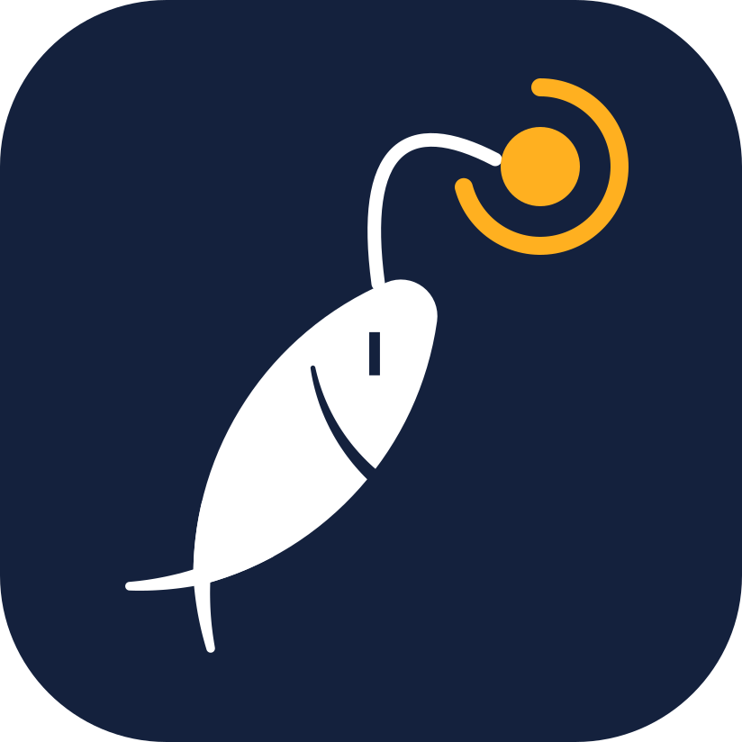

<p align="center">
  
</p>

<h1 align="center">Lanternfish</h1>

<p align="center">
  <strong>Your AI usage limits, always lit.</strong><br>
  Claude, Codex and Gemini subscription usage in the macOS menu bar, plus API spend, so you stop opening settings pages to check.
</p>

<p align="center">
  
  
  
</p>

```
C 84% · X 42% · G 100%
```

The numbers are what is **left**, the way the official usage pages show it.

Click it for the details: each usage window gets a bar that drains from green to orange to red, with its reset countdown underneath, and API spend appears as plain rows.

```
Claude                                  Pro
5-hour                             84% left
████████████████████████████████░░░░░░░░░
Resets in 4h 29m
Weekly                             80% left
...
```

- **Menu bar full? Press ⌃⌥L.** A floating panel with the same bars opens over whatever you are doing, no Accessibility permission needed; press it again, Esc, or click elsewhere to close it.
- **No extra login.** It reuses the sign-ins you already have: Claude Code's token in the macOS Keychain, Codex CLI's `~/.codex/auth.json`, and Antigravity CLI's (`agy`) token in the Keychain for Gemini. Gemini shows the lowest model left in each Antigravity quota pool (Gemini, and Claude & GPT).
- **Nothing leaves your Mac** except the usage request itself, sent straight to Anthropic, OpenAI and Google.
- **One source failing never hides the other.** A broken source shows `—` and the reason.
- **API spend is opt-in.** Add a key under *API Keys* and that row appears; the menu bar title stays subscriptions only.
- **A heads-up when you run low.** One notification each at 20%, 10%, 5% and 0% left, and one when that window resets.
- Refreshes every 5 minutes, or press ⌘R in the menu. Retries within seconds after a network error, and picks up a renewed Claude or Antigravity token within about 15 seconds (the Antigravity token lasts an hour and only renews while `agy` runs).

## Quick start

You need macOS, Python 3.12, and at least one of [Claude Code](https://claude.com/claude-code) or [Codex CLI](https://github.com/openai/codex) signed in with a subscription.

```bash
python3.12 -m venv .venv
.venv/bin/pip install -e ".[dev]"
.venv/bin/lanternfish          # print usage once in the terminal
.venv/bin/python -m lanternfish  # start the menu bar app from the terminal
./macos/build.sh                 # install /Applications/Lanternfish.app
```

The app runs the code in this checkout, so pulling changes only needs a restart, not a rebuild.
Turn on *Start at Login* from the menu (it adds `~/Library/LaunchAgents/com.yuxuanyan.lanternfish.plist`).
Logs go to `~/Library/Logs/Lanternfish.log`.

## How it works

| Source | Credential | Endpoint |
|---|---|---|
| Claude subscription | Keychain item `Claude Code-credentials` | `GET https://api.anthropic.com/api/oauth/usage` |
| Codex subscription | `~/.codex/auth.json` | `GET https://chatgpt.com/backend-api/wham/usage` |
| Anthropic API, this month | Admin API key (`sk-ant-admin…`) | `GET https://api.anthropic.com/v1/organizations/analytics/cost` (beta) |
| OpenAI API, this month | Admin key | `GET https://api.openai.com/v1/organization/costs` |
| DeepSeek API balance | API key | `GET https://api.deepseek.com/user/balance` |

API keys are entered from the *API Keys* menu and stored in your login Keychain (service `lanternfish`); they never touch a file.
"This month" is the current UTC month. Anthropic cost data usually lags by up to 4 hours; OpenAI's is daily.

The two subscription endpoints are **unofficial**: they are what the official apps use, and they may change without notice.
If a token has expired, Lanternfish tells you to run `claude` or `codex login` again; it never refreshes tokens itself.

## Roadmap

- [x] M1: Claude and Codex subscription limits
- [x] M2: API spend (Anthropic, OpenAI, DeepSeek)
- [x] M3: `.app` bundle, start at login, alert above 80%
- [x] M4: logo

## License

MIT
